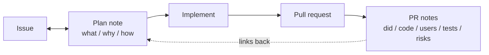

<h1 align="center">pr-notes</h1>

<p align="center">
  A plan note before the code. PR notes after it.<br />
  An agent skill, a PR template, and a zero-dependency CI check that holds every pull request to both.
</p>

<p align="center">
  <a href="#install"></a>
  <a href="LICENSE"></a>
  
  
</p>

---

Agent-written pull requests tend to fail review the same way: nobody wrote down what was meant to
be built before the code appeared, and the description afterwards says "implemented the feature,
all tests pass" with nothing a reviewer can check.

`pr-notes` makes the agent write two short notes around every PR.



**1. The plan note, before the first edit.** What will change, why (with a Mermaid diagram of the
mechanism), and how. It is two-way: you edit it as freely as the agent does, and the agent
re-reads it before coding and before opening the PR. Your edits win.

**2. The PR notes, in the PR body.** Five sections:

| Section | Contains |
|---|---|
| **What I did** | The change as built, and where it differs from the plan. |
| **Codebase affected** | Modules, files, APIs, migrations, config, grouped by area. |
| **Users affected** | Who notices, where, and what they see. |
| **Tests I ran** | The commands and their output, pasted unedited. |
| **Tradeoffs and risks** | What was given up, what could break, how you would notice, how to back it out. |

"Tests I ran" is the one that matters most: real output, failures included, and an honest line
about what was not run.

## Where the notes go

The agent uses the first of these that exists:

1. a notes tool connected to the agent ([Bridge](https://github.com/Atharva-Kanherkar/bridge-harness)
   Notes, Notion, or similar), with the PR notes as a child page of the plan,
2. a comment on the issue, edited in place,
3. a local `.pr-notes/<branch>/plan.md` that is excluded from git.

The PR notes always go in the PR body too.

## Install

```bash
curl -fsSL https://raw.githubusercontent.com/Atharva-Kanherkar/pr-notes/main/install.sh | bash
```

That installs into every agent it finds on the machine. Or pick:

```bash
git clone https://github.com/Atharva-Kanherkar/pr-notes && cd pr-notes
./install.sh --agent claude          # ~/.claude/skills
./install.sh --agent codex,cursor    # ~/.codex/skills, ~/.cursor/skills
./install.sh --agent opencode        # ~/.config/opencode/skills
./install.sh --project               # ./.claude/skills in the current repo
./install.sh --dir ~/path/to/skills  # any other agent
```

Start a new agent session afterwards. The skill triggers on its own when the agent picks up an
issue or opens a PR; you can also say "use pr-notes".

## Enforce it in a repository

Ask the agent to "make pr-notes a rule for this repo", or copy three files yourself:

```bash
mkdir -p .github/workflows scripts
cp assets/github/pull_request_template.md .github/pull_request_template.md
cp assets/github/workflows/pr-notes.yml   .github/workflows/pr-notes.yml
cp scripts/check-pr-notes.mjs             scripts/check-pr-notes.mjs
```

The `PR notes` check then fails any PR whose body is missing a section, has a section with no
real content (template comments and `TODO` do not count), or has no fenced output under
"Tests I ran". Make it a required check in branch protection if you want it to block merges.

Drafts, bot authors, the `format-exempt` label and `<!-- pr-format: exempt -->` in the body all
skip it.

Check a body locally before opening the PR (`gh pr create` skips the template):

```bash
node scripts/check-pr-notes.mjs body.md
gh pr view 123 --json body -q .body | node scripts/check-pr-notes.mjs
```

## What's in here

```
SKILL.md                         the workflow the agent follows
references/plan-note.md          plan note template and a filled example
references/pr-notes.md           PR notes template, a filled example, and weak versions to avoid
scripts/check-pr-notes.mjs       the checker (Node 18+, no dependencies)
assets/github/                   PR template and GitHub Actions workflow to drop into a repo
test/                            node --test test/*.test.mjs
```

## License

MIT
