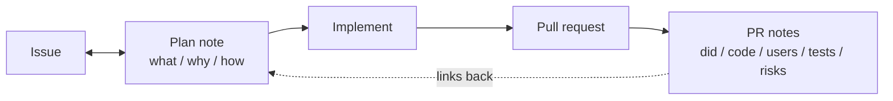

# PR notes

A reviewer should be able to judge a change from two short notes before opening the diff. One is
written before the code and says what will be built and why. The other is the PR body and says
what actually happened, who it reaches, the proof, and what could go wrong.



Skip the skill only for work that will never become a PR (a question, a one-off script, a
throwaway spike the user called a spike).

## Where the notes live

Use the first one that exists, and tell the user where the note is, as a link when you have one.

1. **A notes tool connected to you.** Bridge Notes (`notes_create`, `notes_read`, `notes_edit`),
   Notion, or similar. The plan note is a page; the PR notes are a child page of it. In Bridge,
   create the plan as kind `note`, not `task`: a task cannot have child pages.
2. **The issue.** Post the plan note as an issue comment
   (`gh issue comment <n> --body-file plan.md`) and keep editing that same comment
   (`gh api -X PATCH repos/{owner}/{repo}/issues/comments/<id> -F body=@plan.md`).
3. **Neither.** Write `.pr-notes/<branch>/plan.md`, add `.pr-notes/` to `.git/info/exclude` so it
   is never committed, and show the user the path.

The PR notes always also go in the PR body, because that is where reviewers read.

## Step 1: the plan note, before the first edit

Reading code to understand the problem is fine. Editing files is not, until the plan note exists.
Fill [references/plan-note.md](references/plan-note.md):

- **What**: the change in a few lines, and what is deliberately out of scope.
- **Why**: the problem, and a Mermaid diagram of the mechanism: the flow that breaks, the data
  path, the before and after. A diagram that only restates the headings is decoration; draw the
  thing a reviewer would otherwise have to reconstruct from the code.
- **How**: the files and symbols to touch, the steps, and the tests that will prove it works.

**The plan note is two-way.** The human edits it as freely as you do.

- Stop and wait for the user after writing it when they asked to review the plan, or when the
  change is hard to undo (a migration, a public API or wire format, deleting data, auth or
  permissions). Otherwise share the link and continue.
- Re-read the note right before you start coding and again before you open the PR. If the human
  changed it, their edit wins over your earlier plan and over anything said earlier in the chat.
- When the work diverges from the plan, edit the note (a short "Changed during implementation"
  line under How) rather than drifting silently.

## Step 2: implement

Implement from the note. Run the tests you named under How, and keep their raw output; you will
paste it.

## Step 3: the PR notes

Fill [references/pr-notes.md](references/pr-notes.md). Link the plan note and the issue at the
top, then write five sections. [references/pr-notes.md](references/pr-notes.md) has a filled
example and what a weak section looks like.

| Section | Contains |
|---|---|
| **What I did** | The change as built. Say where it differs from the plan note. |
| **Codebase affected** | Modules, files, APIs, migrations, config, CI, grouped by area. Not a file dump. |
| **Users affected** | Who notices, on which surface or platform, and what they see. "No user-facing change" plus the reason is a valid answer. |
| **Tests I ran** | Each command and its output, pasted unedited in a fenced block. Name what you did not run and why. |
| **Tradeoffs and risks** | What you gave up, what could break, how far it would spread, how someone would notice, how to back it out. |

Rules for **Tests I ran**, because this is the section people fake:

- Paste the real output. Never rewrite, summarize inside the block, or "clean up" a failure.
- Long output may be trimmed only with an explicit marker such as `[... 340 passing lines trimmed ...]`,
  and never trim a failure, warning, or skip.
- Failures and flakes stay in, with a line saying what you did about them.
- Never list a test you did not run. "Not run: the e2e suite, needs a staging account" is a
  complete, honest answer.

For UI changes, add a `## Screenshots` section.

Before creating the PR, check the body:

```bash
node <this skill's directory>/scripts/check-pr-notes.mjs body.md
gh pr create --title "<title>" --body-file body.md
```

`gh pr create` skips the repository's PR template, so the checker is the only thing between you
and an incomplete body. It exits non-zero and names each missing or empty section.

Then save the PR notes where the plan note lives: a child page of it in a notes tool, or a reply
on the issue.

## Enforcing it in a repository

When the user asks to make this a rule for a repo, copy the assets in and add the rule to the
agent instruction files:

```bash
mkdir -p .github/workflows scripts
cp <skill>/assets/github/pull_request_template.md .github/pull_request_template.md
cp <skill>/assets/github/workflows/pr-notes.yml .github/workflows/pr-notes.yml
cp <skill>/scripts/check-pr-notes.mjs scripts/check-pr-notes.mjs
```

Then add a short "Pull requests" section to `AGENTS.md` and `CLAUDE.md` (whichever the repo has)
naming the two notes and the checker command. Making the `PR notes` check required in branch
protection is the user's call; offer it, do not do it unasked.

The check skips drafts, bot authors, the `format-exempt` label, and bodies containing
`<!-- pr-format: exempt -->`.

## Writing style

Plain and specific. Short and true beats long and padded. Every claim in the PR notes should be
something a reviewer could check: a file, a command, an output line, a screen.
