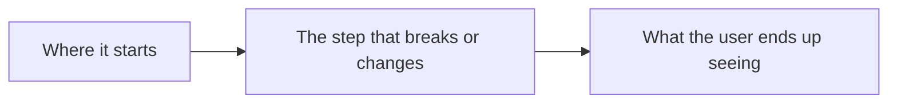
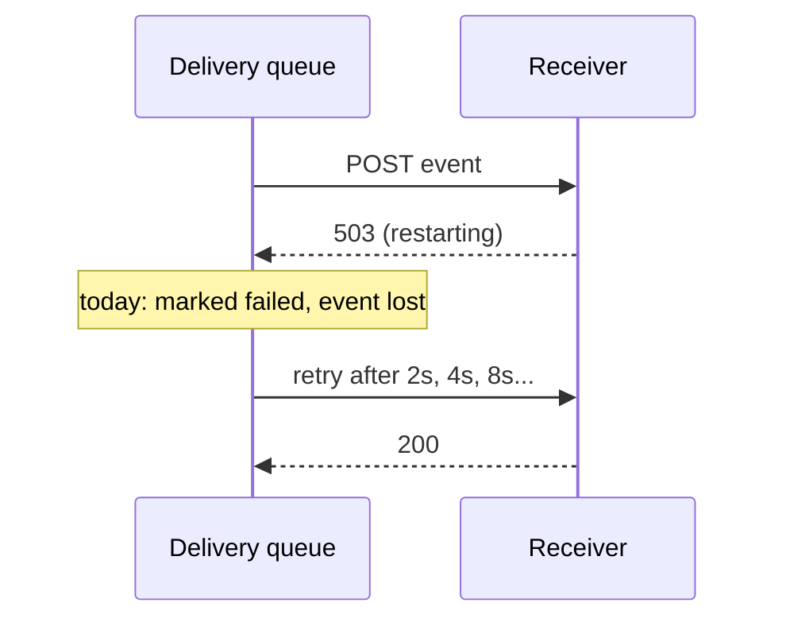

# Plan: <short title>

Issue: <link or "none">
Two-way note: edit anything below. The agent re-reads this before coding and before the PR, and
your edits win.

## What

<The change in two to five lines.>

Out of scope: <what this deliberately does not do>.

## Why

<The problem in a few lines: who hits it, what happens, why it matters now.>

## How

- `<path/to/file>`: <what changes there>
- `<path/to/other>`: <what changes there>
- Tests: <the tests that will prove it, new or existing, and the commands to run them>
- Risky bits to look at first: <anything hard to undo>

---

## Example

# Plan: retry webhook delivery on 5xx

Issue: #412

## What

Webhook delivery retries up to 5 times with exponential backoff when the receiver answers 5xx or
times out. 4xx answers are still final.

Out of scope: a dead-letter queue UI, retries for 4xx.

## Why

A receiver that restarts for 30 seconds loses every event sent in that window, and customers have
no way to replay them.

## How

- `src/webhooks/deliver.ts`: classify the response; schedule a retry for 5xx and timeouts.
- `src/webhooks/backoff.ts` (new): delay = 2^attempt seconds with jitter, capped at 5 attempts.
- `migrations/0042_webhook_attempts.sql`: `attempts` and `next_attempt_at` columns.
- Tests: unit tests for the classifier and backoff; an integration test with a receiver that
  fails twice then succeeds. `npm test -- webhooks`.
- Risky bits: the migration on a large table; check it does not lock.
