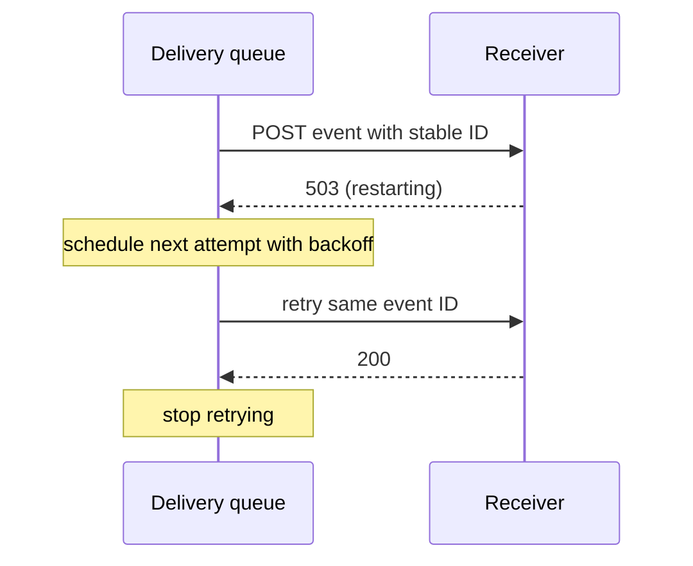

# Plan: <short title>

Issue: <link or "none">
Shared note: edit anything below. The agent re-reads it before coding and before the PR.

Use this in a notes page or the PR body. Without a notes app, keep it under `## Plan` in an
existing draft PR; if no PR exists, stage it locally before coding and include it in the first
PR description. Use `### What`, `### Why`, and `### How` inside the PR's plan section.

Keep depth proportional to the change. A few sentences can cover a tiny fix; the prompts below
guide the content, not a required interview. Add a diagram when it explains the mechanism.

## What

<Observable change, who or what it affects, and the scope in two to five lines.>

Done when: <testable criteria, including an important failure case when relevant>.

Out of scope: <what this deliberately does not do>.

## Why

<The problem, supporting evidence, and why the outcome matters.>

Assumptions: <what we believe but have not established; what would make this approach wrong?>.

Simpler alternative: <reuse, a smaller change, or leaving behavior alone; why choose this approach?>.

## How

- `<path/to/file>` / `<symbol>`: <what changes there>
- Impact: <affected people, agents, or systems; entry points/callers to trace; compatibility>
- Verification: <criterion -> observable check and exact command; what it will not establish>
- Risk and review focus: <consequential failures, detection, rollback, and who should review>

If scope changes, add "Changed during implementation: <what changed and why>" here and keep
the criteria current. Do not replace an earlier plan with a fictional history.

---

## Small-change example

# Plan: fix the documented test command

Issue: none

## What

Correct the README command so it runs the checker tests. Done when the documented command
succeeds from a fresh checkout with Node installed. Out of scope: changing the test suite.

## Why

The documented path does not exist. Assumption: the checked-in Node test suite is the intended
entry point. Correcting the command is smaller than adding an alias for the mistaken path.

## How

Edit `README.md`, then run `node --test test/*.test.mjs`. Contributors and agents following the
README get a working test command; runtime behavior is unchanged. This checks the documented
entry point, not the installer. Review the one-line diff. Revert the edit if needed.

## Substantial-change example

# Plan: retry webhook delivery on 5xx

Issue: #412

## What

Retry delivery on 5xx responses and timeouts with exponential backoff and jitter, up to five
retries (six attempts total). Keep 4xx responses final.

Done when: a receiver failing twice then returning 200 gets the event; 4xx responses schedule
no retries; delivery stops after six total attempts; duplicate delivery retains the event ID.

Out of scope: a dead-letter queue UI, retries for 4xx, changing receiver deduplication.

## Why

The issue's delivery logs show events marked failed during a receiver restart, with no later
attempt. Retries should let receivers recover from short outages.

Assumptions: receivers deduplicate using the existing event ID; extra requests are acceptable.
A receiver that processes an event but times out before replying could otherwise duplicate work.

Simpler alternative: manual replay avoids extra requests but requires intervention during each
short outage. Automatic retries address that failure; keep manual replay unchanged.

## How

- `src/webhooks/deliver.ts`: classify responses and preserve the event ID across attempts.
- `src/webhooks/backoff.ts` (new): delays starting at 2s with jitter; six attempts total.
- `migrations/0042_webhook_attempts.sql`: nullable `attempts` and `next_attempt_at` columns.
- Impact: webhook receivers get extra attempts; operators monitor queue depth; API clients
  keep the event format. Trace the delivery worker, scheduler, and dashboard attempt counter.
- Verification: classifier and backoff unit tests plus integration cases for recovery, timeout,
  final 4xx, exhaustion, and stable event IDs. Run `npm test -- webhooks`, then `npm test`.
- Gap: local tests do not establish queue capacity during a mass outage; run the staging load
  test before raising production retry traffic.
- Review first: scheduling boundaries and delivery state transitions. A worker restart must not
  lose a scheduled attempt or cause the cap to be exceeded.
- Risk: migration locks and increased receiver load. Inspect the migration plan, monitor retry
  queue depth and delivery failures, and disable retries with `WEBHOOK_MAX_ATTEMPTS=1` if needed.
